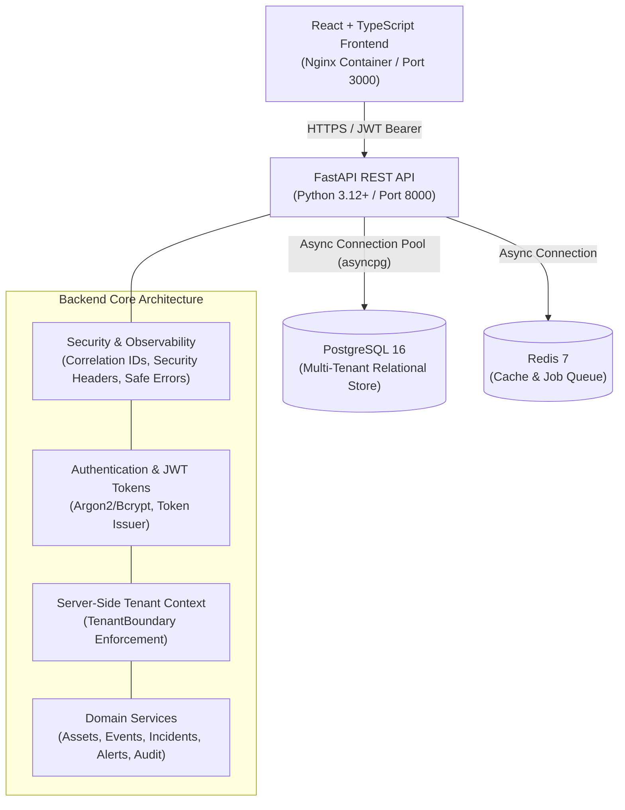

# AegisSOC AI — System Architecture Document

## 1. System Overview
**AegisSOC AI** is an evidence-grounded autonomous security operations, adversary validation, and continuous security improvement platform. Built on zero-trust principles and defensive cybersecurity best practices, AegisSOC centralizes multi-source telemetry, enforces strong tenant isolation, tracks security assets, and facilitates forensic incident response.

---

## 2. Core Architectural Pillars

### 2.1 Defense-in-Depth Layering
- **Perimeter Security**: Custom security headers (`X-Frame-Options: DENY`, `X-Content-Type-Options: nosniff`, `Strict-Transport-Security`, `Content-Security-Policy`).
- **Input Sanitization**: Pydantic v2 schemas rigorously validating incoming payloads against strict boundary rules.
- **Tenant Context Extraction**: Tenant identity is decoded strictly from authenticated server-side JWT claims. Client requests can never dictate or override their `tenant_id`.
- **Query Scoping**: Every database access explicitly limits its scope with `WHERE tenant_id = :authenticated_tenant_id`.
- **Safe Failure Modes**: Unhandled exceptions trigger the `ErrorHandlingMiddleware`, which emits structured JSON logs with correlation IDs (`X-Request-ID`) and presents generic error messages to clients without revealing internal stack traces.

### 2.2 Technology Stack
| Layer | Technology | Justification |
| :--- | :--- | :--- |
| **Backend Framework** | Python 3.12+ / FastAPI | High throughput async I/O, native OpenAPI documentation, strict Pydantic v2 validation. |
| **Database** | PostgreSQL 16 | ACID-compliant relational storage, native JSONB support, composite indexing. |
| **ORM & Migrations** | SQLAlchemy 2.0 (Async) + Alembic | Type-safe declarative models, async connection pooling, deterministic schema versioning. |
| **Caching & Queues** | Redis 7 | Sub-millisecond rate-limiting and job state management. |
| **Frontend UI** | React 18 + TypeScript + Vite | Componentized responsive UI, type safety, cyber SOC styling. |
| **Linting & Code Quality** | Ruff | Ultra-fast Python linting, isort formatting, and flake8-bandit security vulnerability analysis. |
| **Testing** | Pytest, pytest-asyncio, Vitest | Async integration and unit tests verifying cross-tenant boundaries. |

---

## 3. Data Flow & Telemetry Ingestion
1. **Log Ingestion**: Telemetry from endpoint detection & response (EDR), firewalls, auth servers, and cloud providers arrives at `POST /api/v1/events`.
2. **Tenant Tagging**: Server injects authenticated `tenant_id` from the caller's JWT context.
3. **Normalization**: The raw payload is transformed into standardized ECS/OCSF compliant fields (`@timestamp`, `event.category`, `source.ip`, `host.hostname`).
4. **Automated Alerting**: Events flagged with `HIGH` or `CRITICAL` severity automatically trigger detection alerts for SOC analysts.
5. **Audit Trail**: The action is recorded in `audit_logs` with actor details, action type, and status.
